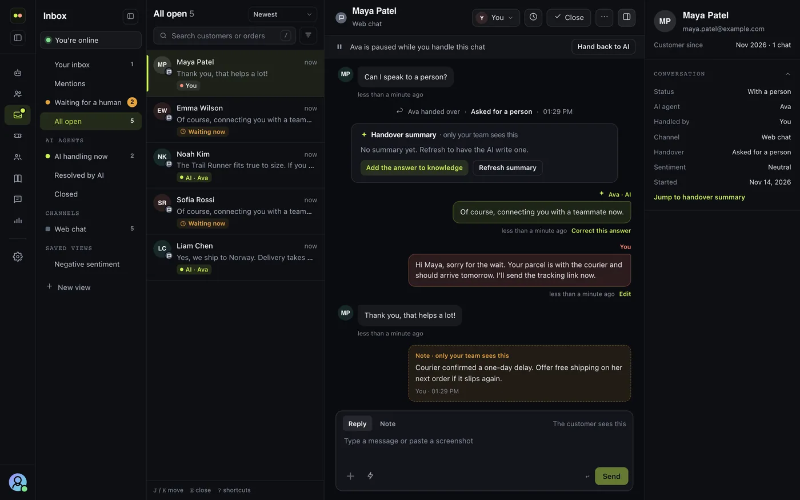

# Inbox

Every conversation, from every channel, in one place. The AI answers what it can; the inbox is where your team picks up the rest.

<Frame>
  
</Frame>

The inbox has four parts: the **views** on the left, the **list** of conversations in the selected view, the **thread** you are reading, and the **details** of the customer beside it. Below 1440px the details open over the thread; on a phone the list and the thread take turns, and Back returns to the list.

## Views

| View | What it lists |
| --- | --- |
| **Your inbox** | Chats you hold |
| **Mentions** | Open chats where a teammate @-mentioned you in a note |
| **Waiting for a human** | Handed over by the AI, or queued for the team, and nobody has taken them yet. The row says how long they have waited, and turns *late* after a while |
| **All open** | Every open chat you can see |
| **Snoozed** | Chats taken out of the views until later (shown while there are any) |
| **AI handling now** | Chats the AI is answering |
| **Resolved by AI** | Closed today without a person |
| **Closed** | Closed chats |
| **Channels** | All open chats on one channel (web chat, WhatsApp, Instagram, …) |
| **Saved views** | *Negative sentiment*, and the views you and your team saved |

Each view shows its count. Sort by **Newest** or **Waiting longest**, search by customer name, email or order, and filter by AI agent or by teammate.

Every row says who has the chat: **AI**, **Waiting**, **You**, or a teammate's name.

## Working a chat

<CardGroup cols={2}>
  <Card title="Take over" icon="user-check">
    Stop the AI and answer yourself. The customer is told a person joined.
  </Card>
  <Card title="Hand to my team" icon="users">
    Take the AI out without taking the chat: it waits for whoever is free.
  </Card>
  <Card title="Hand back to AI" icon="sparkles">
    You are done: the customer is told, and the AI answers their next message.
  </Card>
  <Card title="Assign" icon="user-arrows">
    Give the chat to a teammate. It leaves your inbox at once.
  </Card>
</CardGroup>

- **Close** asks first, tells the customer the conversation has ended, and on web chat asks them for a rating. The next conversation in the list opens. **Send and close** sends your reply, then closes.
- **Reopen** a closed chat from the bar under it. It opens again as yours, so you reply next and the AI stays out. The customer isn't told until you write.
- AI-handled chats close on their own after 24 hours without a message.

### Notes and mentions

Switch the composer to **Note** to write to your team. Only your team sees notes. Type **@** to mention a teammate: they are notified and the chat shows under their **Mentions**.

### Editing a reply

You can edit a reply you sent for 15 minutes, while the chat is open: choose **Edit** next to its time, change the text, and press Enter (Esc cancels). The reply is marked **Edited**, and the first text is kept.

The customer sees the change where the channel allows it:

| Channel | The customer's copy |
| --- | --- |
| Web chat | Changes in place, marked *Edited* |
| Telegram, Slack | Changes on the platform |
| WhatsApp, Messenger, Instagram, SMS, email | Can't change once sent, so there is no Edit |

### Keyboard

| Key | Does |
| --- | --- |
| **J** / **K** | Next / previous conversation |
| **/** | Search |
| **E** | Close the chat you hold (then **Enter** to confirm) |
| **?** | Show the shortcuts |
| **Esc** | Close a dialog or the details drawer |

## Snooze

Take a chat you hold out of the views until later: for an hour, three hours, until tomorrow 9:00 or next Monday 9:00. It comes back then, or as soon as the customer writes. A snoozed chat says so above the thread, with **Unsnooze**. A chat waiting for a person can't be snoozed: assign it first.

## Saved replies

Write an answer once and send it in two keystrokes: type **/** and its shortcut in the reply box, or pick it from the saved replies button. Replies can fill in the customer's name, first name and email (`{{customer.name}}`, `{{customer.first_name}}`, `{{customer.email}}`) and yours (`{{agent.name}}`, `{{agent.first_name}}`). Add, edit and remove them in **Settings › Saved replies**, or use **Save as saved reply** on what you just typed.

## Saved views

Set up the list the way you work (a view, a channel, an AI agent or teammate, the sort and a search) and choose **New view** under the views to save it under a name. One click, or its link, brings it all back. The ⋯ beside a view renames it, saves the list's current filters into it, shares it with the team, or deletes it. Sharing a view, and changing one someone else shared, is for people who manage all chats.

## AI help

- **Improve** rewrites what you typed: clearer, friendlier, shorter, or with the spelling fixed. **Undo** puts your text back.
- **Refresh summary** has the AI summarize the conversation as it stands now. The summary the AI wrote at the handover is on the card above the team's first reply.
- **Add the answer to knowledge** appears once your team has answered the customer's question in full. The AI checks the answer is complete and reusable, and opens the help center editor with a general question and answer, without the customer's details. When it isn't ready, it says what's missing.

Each AI answer counts as one of your plan's AI messages on the ChatterMate model. With your own model key, nothing is counted.

## Customer details

Beside the thread: who the customer is (name, email, phone and anything your site passed in), the conversation (status, AI agent, who handles it, channel, handover reason, sentiment), and its linked ticket.

On ChatterMate Cloud the panel also shows when the customer was first seen and how many chats they've had, their previous conversations (open one with a click), and, when the chat's AI agent is connected to Shopify, their latest orders, each opening in Shopify. Orders found by an email the customer only typed, rather than confirmed, say so.

## Live updates

The inbox updates as things happen: new messages, the AI's answers, a teammate taking or assigning a chat, notes, and closes. Counts refresh on their own.

## Features by plan

On ChatterMate Cloud, each inbox feature comes with a plan. Each plan includes everything in the plans above it.

| Plan | Inbox features |
| --- | --- |
| **Free** | The inbox and its views, take over, hand to team, assign, close and reopen, notes and @-mentions, editing a reply, customer details with previous conversations and Shopify orders, snooze, up to 10 saved replies and 3 saved views each |
| **Starter** | As many saved replies and views as you like, sharing views with the team, and AI help: Improve and Refresh summary |
| **Growth** | AI-checked help articles from conversations (with the help center) |
| **Pro** | Everything in Growth |

On a lower plan, what your team saved stays saved and usable; you can't add past the plan's limit until you upgrade.

Self-hosted installs have the inbox, its views, notes and mentions, editing replies, and customer details. Snooze, saved replies, saved views, AI help and the customer's history and orders are ChatterMate Cloud features.
