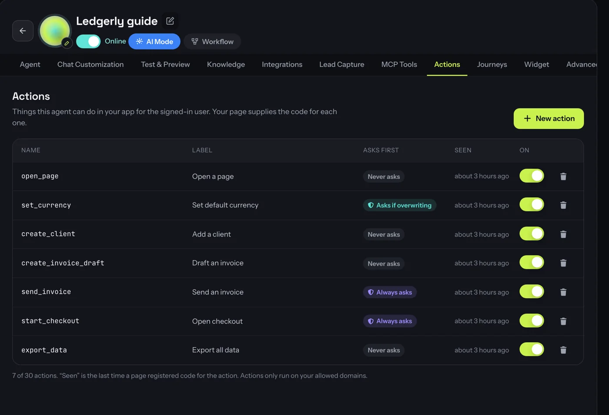
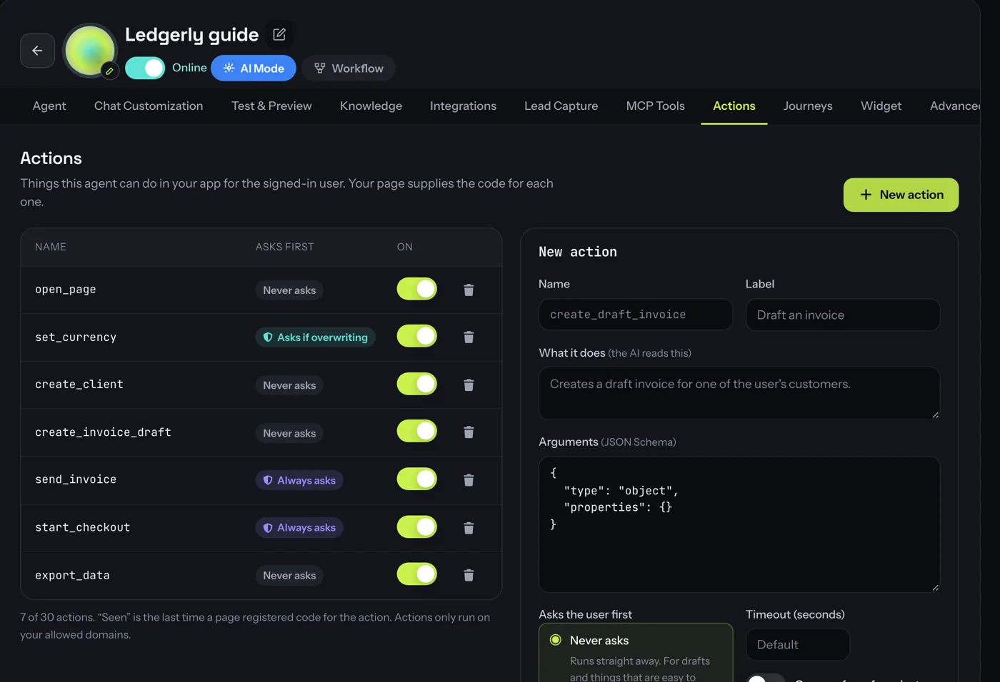
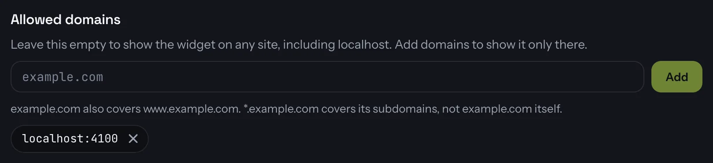
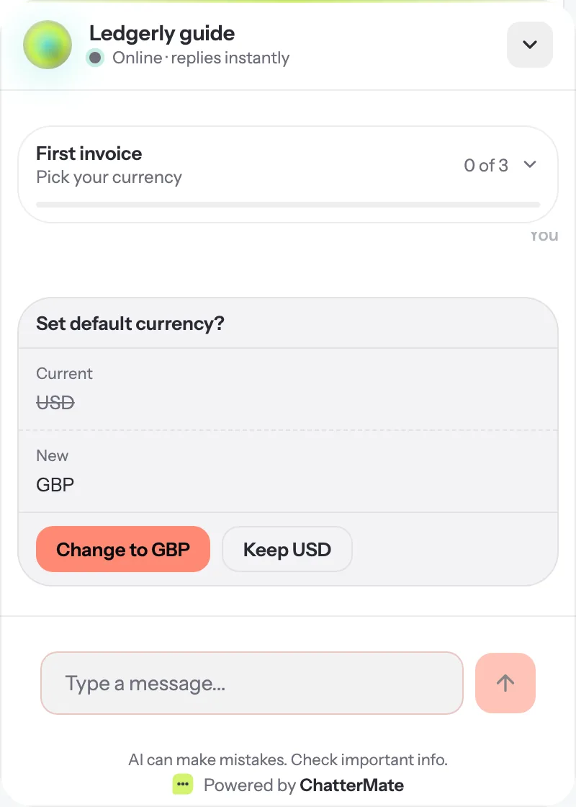
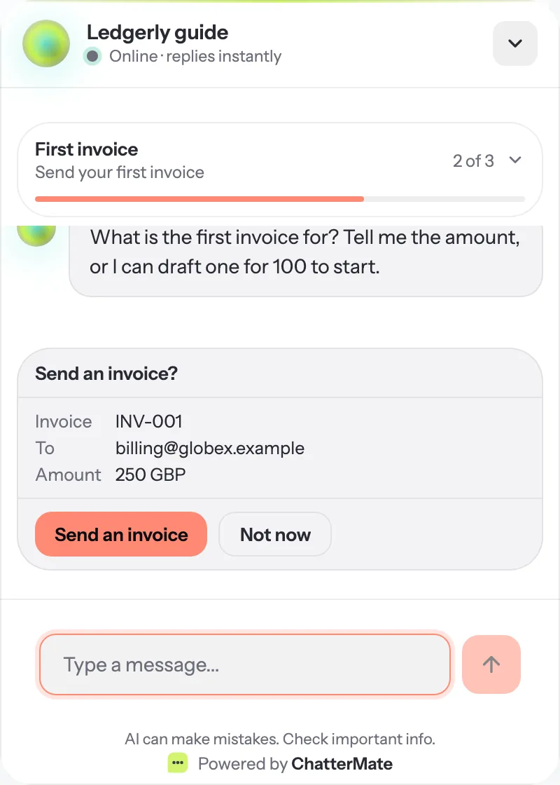
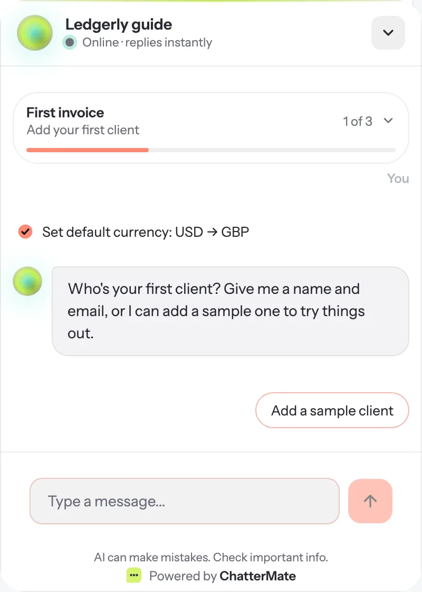

# In-app actions

In-app actions let your agent **do things inside your web app** for the user who is signed in.
For example, it can switch their currency, add a client or send an invoice. The user doesn't
have to go and find the right screen.

You declare each action in ChatterMate. Your page supplies the code that runs it. The agent can
only call actions that are both declared **and** registered by the page that is open, and only
in the chat widget on your own site.

<CardGroup cols={3}>
  <Card title="Runs as the user" icon="user-shield">
    The code runs in your page, with the user's own session. Your API checks permissions
    exactly as it does for a click.
  </Card>
  <Card title="Asks first" icon="hand">
    Risky actions show a confirm card. The model can't press it for the user.
  </Card>
  <Card title="Configurable by AI" icon="robot">
    Everything here can also be set up with the [CLI](/features/cli) or the
    [MCP server](/features/mcp-server).
  </Card>
</CardGroup>

## How it works

<Steps>
  <Step title="Declare the action">
    On the agent's **Actions** tab, say what the action is called, what it does and what
    arguments it takes.
  </Step>
  <Step title="Register the code on your page">
    Call `ChatterMate.registerActions({ name: handler })` in your app. The widget tells
    ChatterMate which declared actions this page can run.
  </Step>
  <Step title="The agent calls it">
    When the user asks for something an action can do, the model calls it. ChatterMate
    checks the arguments against your schema. If the action asks first, the widget shows a
    confirm card. Then your handler runs in the page.
  </Step>
  <Step title="The result goes back to the agent">
    Whatever your handler returns is passed to the model, which replies. A line in the chat
    records what was done.
  </Step>
</Steps>

## 1. Declare actions

Open **AI Agents → your agent → Actions** and click **New action**.

<Frame>
  
</Frame>

<Frame>
  
</Frame>

| Field | What it's for |
| --- | --- |
| **Name** | The code name your page registers, in `lowercase_with_underscores`, e.g. `send_invoice`. |
| **Label** | What the user sees on the confirm card and in the chat, e.g. *Send an invoice*. |
| **What it does** | Read by the AI to decide when to use the action. Say when to use it and when not to. |
| **Arguments** | A JSON Schema object. Arguments are validated against it before your code runs. |
| **Asks the user first** | `Never asks`, `Always asks` or `Asks if overwriting` (see [Confirm cards](#confirm-cards)). |
| **Timeout** | How many seconds your handler has. The default is 20 and the most is 120. |
| **Only opens a form** | For sensitive data. The action opens your own form and never takes IDs, bank or health details as arguments. |

The **Seen** column shows the last time a page registered code for the action. *Not yet* means
no page has offered it, so the agent can't use it. Use the toggle to turn an action off without
deleting it.

<Note>
The Free plan allows 3 actions per agent. Paid plans allow more; the count is shown under the
table.
</Note>

## 2. Limit the widget to your site

Actions only run when the widget is limited to the site it is on. Open the agent's **Widget**
tab and add your app's domain under **Allowed domains**.

<Frame>
  
</Frame>

`example.com` also covers `www.example.com`. `*.example.com` covers its subdomains but not
`example.com` itself. If the list is empty, the widget loads anywhere and in-app actions are
off.

## 3. Register the code on your page

Add the [widget script](/features/widget) as usual, then register a handler for each action.
A handler is an `async` function that gets the arguments and returns a result:

```js
ChatterMate.registerActions({
  // A plain function: runs straight away.
  create_client: async ({ name, email }) => {
    const client = await api.post('/clients', { name, email })
    return { id: client.id, summary: `Added ${client.name}` }
  },

  // { run, preview } for "Asks if overwriting": preview shows current vs new.
  set_currency: {
    preview: async ({ code }) => {
      const current = (await api.get('/settings')).currency
      return current === code ? null : { before: current, after: code }
    },
    run: async ({ code }) => {
      await api.patch('/settings', { currency: code })
      return { currency: code, summary: `Set default currency: ${code}` }
    },
  },

  // For "Always asks": preview fills the card with what will happen.
  send_invoice: {
    preview: async () => {
      const draft = await api.get('/invoices/latest-draft')
      return { details: { Invoice: draft.number, To: draft.email, Amount: draft.total } }
    },
    run: async () => {
      const sent = await api.post('/invoices/latest-draft/send')
      return { number: sent.number, summary: `Sent ${sent.number} to ${sent.email}` }
    },
  },
})
```

- **Return** plain JSON. It goes to the model as data. A `summary` string becomes the line
  shown in the chat.
- **Throw** an error to fail. The message (up to 200 characters) goes to the model, which tells
  the user what went wrong.
- Each call runs **once**. If the widget reconnects in the middle of a call, the page sends back
  the result it already has rather than running the handler again.
- Call `ChatterMate.unregisterActions()` when the user signs out, or when the page hands the
  widget to another agent.

<Tip>
Actions act with the signed-in user's own rights, so identify the user with an
[identity token](/features/widget#login-and-logout-in-a-single-page-app). Your API keeps
enforcing permissions as it does today.
</Tip>

## Confirm cards

The confirm card is drawn by the widget, not written by the model, so a reply can't approve an
action for the user.

<Tabs>
  <Tab title="Asks if overwriting">
    The widget calls your `preview(args)`. If it returns `{ before, after }`, the user sees the
    current and new values. The buttons say what happens: **Change to GBP** or **Keep USD**.
    If `preview` returns `null` (nothing would change), the action runs straight away.

    <Frame>
      
    </Frame>
  </Tab>
  <Tab title="Always asks">
    Use this for anything with an effect outside the app, such as sending, paying or deleting.
    The card shows the details your `preview` returns, or the arguments if it returns none.

    <Frame>
      
    </Frame>
  </Tab>
</Tabs>

After an action runs, a short line records it in the chat:

<Frame>
  
</Frame>

**Which to pick:** use *Never asks* for drafts and things that are easy to undo. Use *Asks if
overwriting* for settings and imports. Use *Always asks* for anything that sends, pays or
deletes.

## Tell the agent what's on screen

`setContext` passes page state the agent can use, such as the plan the user is on or the screen
they are looking at:

```js
ChatterMate.setContext({ plan: 'free', step: 'billing', invoices_sent: 0 })
```

- Values are short strings, numbers or booleans. There can be up to 50 keys and 4 KB in total.
  Keys are `lowercase_with_underscores`.
- Page context is **not verified**. The agent treats it as information, never as permission. To
  say who the user is, use the identity token: its fields are the verified `user.*` values.
- Call it again whenever the state changes; the latest values replace the old ones.

## More from the page

| Call | What it does |
| --- | --- |
| `ChatterMate.prompt({ message, suggestions, open })` | Shows a message from your app, with optional reply buttons. With `open: true` it also opens the chat. Nothing is stored or counted until the user replies. |
| `ChatterMate.notify('invoice_sent')` | Tells ChatterMate something happened in your app. [Journeys](/features/journeys) use events to start, finish steps and record goals. |
| `ChatterMate.startJourney('first_invoice')` | Starts a journey from your own code. |
| `ChatterMate.unregisterActions()` | Forgets the page's actions, context and unsent events. |

## Safety

- **Allowlist only.** The model is offered only actions that are declared, turned on and
  registered by the open page, on a widget limited to your domains.
- **Validated arguments.** Arguments are checked against your schema on the server before the
  page sees them.
- **No secrets in chat.** The chat box holds back messages that look like passwords, API keys
  or card numbers. Use *Only opens a form* for sensitive data, so it is only ever typed into
  your own form.
- **Fenced data.** Page context and action results reach the model as data, not instructions,
  so text on a page can't take over the agent.
- **Not on other channels.** Actions are offered in the website widget only, never on WhatsApp,
  email or other channels.

## Set it up with the CLI or an AI assistant

```bash
chattermate action create <agent-id> --name send_invoice --label "Send an invoice" \
  --description "Sends the user's latest draft invoice" --confirm always
chattermate action list <agent-id>
chattermate widget domains <widget-id> --set app.example.com
```

Or ask an assistant connected to the [MCP server](/features/mcp-server): *"Declare a
set_currency action on my agent that asks before overwriting, and limit its widget to
app.example.com."*

## Next steps

<CardGroup cols={2}>
  <Card title="Journeys" icon="route" href="/features/journeys">
    Walk new users through setup step by step, using your actions.
  </Card>
  <Card title="Widget integration" icon="code" href="/features/widget">
    Embed the widget and identify signed-in users.
  </Card>
</CardGroup>
