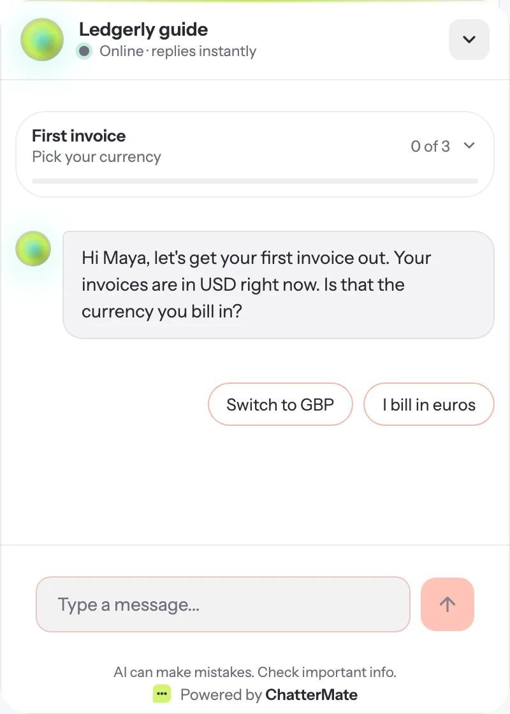
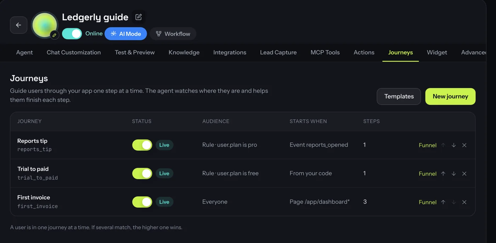
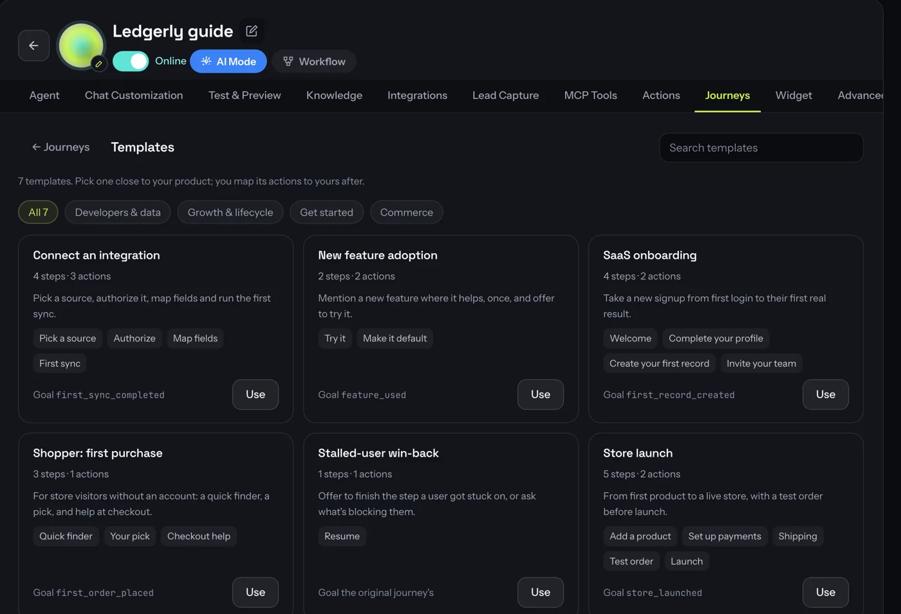
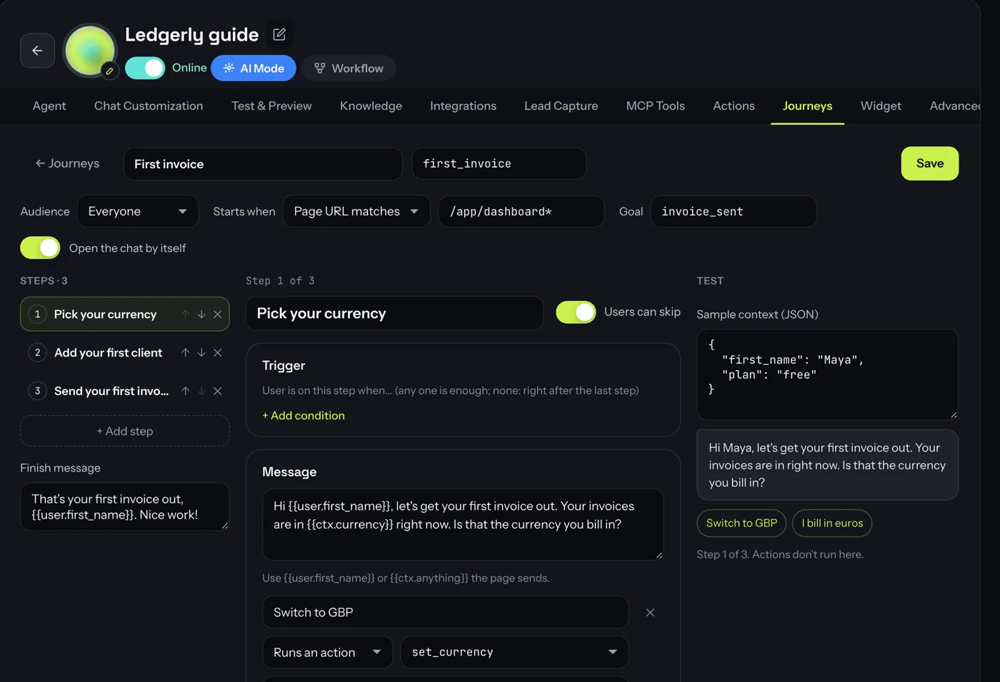
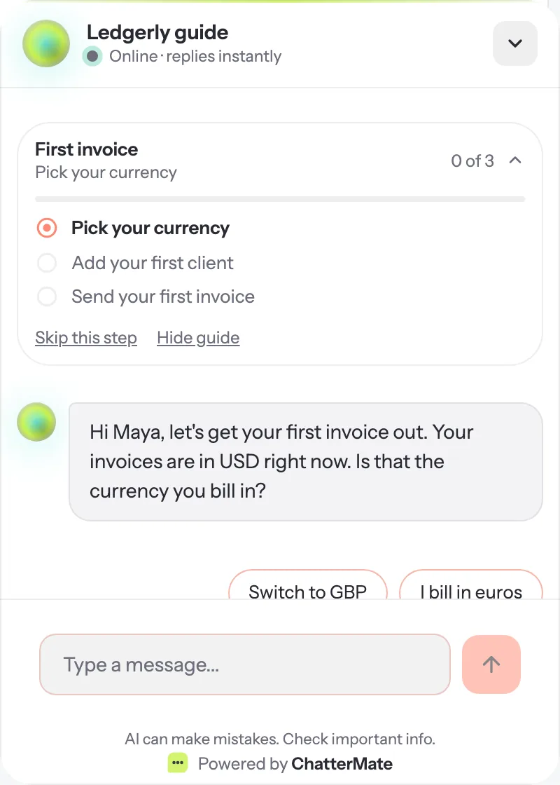
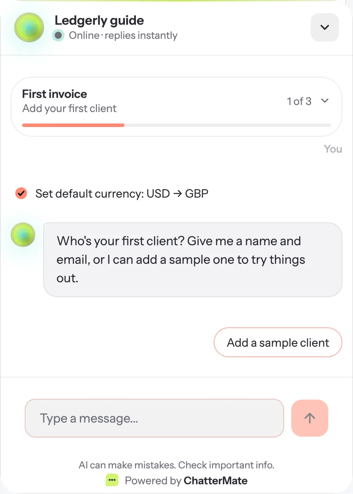
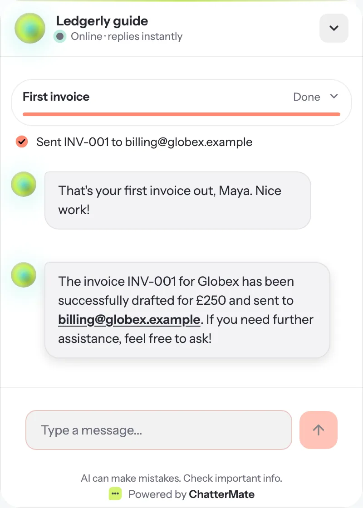
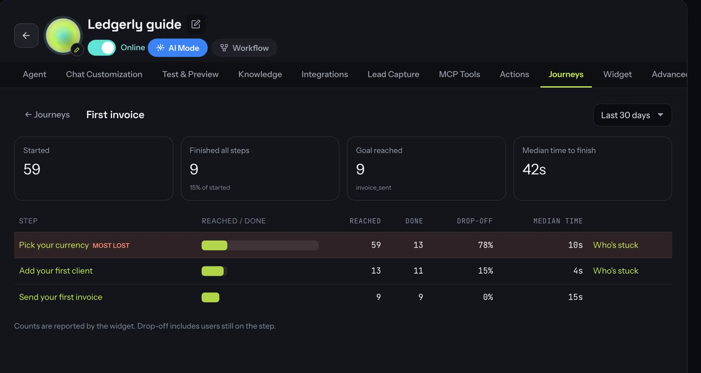

# Journeys

A journey is a short guided path through your app, such as *Send your first invoice* or
*Connect an integration*. The chat widget shows the user where they are, offers to do each step
for them with your [in-app actions](/features/in-app-actions), and moves on when the step is
done. You see where users stop in a funnel.

<Note>
Journeys are available on the **Growth** and **Pro** plans. Self-hosted installs have them with no
plan limits.
</Note>

<Frame>
  
</Frame>

## How it works

- A journey **starts** when its trigger happens: the user opens a page, your app sends an event,
  or your code starts it.
- Each **step** has a message, suggested replies, and a rule for when it is **done**. That can be
  an action succeeding, an app event, or a page field reaching a value.
- The guide stays pinned at the top of the chat. The user can open it to see every step, skip a
  step or hide the guide.
- The agent sees which step the user is on, so a typed request like *"add Globex as a client"*
  runs the right action and moves the guide on.
- ChatterMate keeps each user's progress, so it continues on their next visit or device when
  the user is [identified](/features/widget#login-and-logout-in-a-single-page-app).

## Before you start

<Steps>
  <Step title="Declare your actions">
    Set up the [in-app actions](/features/in-app-actions) the steps will use, and register them on
    your page.
  </Step>
  <Step title="Limit the widget to your site">
    Add your app's domain under **Widget → Allowed domains**.
  </Step>
  <Step title="Send page context and events (optional)">
    `ChatterMate.setContext({...})` lets steps use fields like `{{ctx.currency}}`.
    `ChatterMate.notify('invoice_sent')` reports things that happen in your app.
  </Step>
</Steps>

## Create a journey

Open **AI Agents → your agent → Journeys**. Start from a template, or click **New journey**.

<Frame>
  
</Frame>

### Templates

The templates follow what onboarding research shows works: short, done in context, and
finished by a real result rather than by reaching the last screen. Pick one close to your
product, then map its actions to yours.

<Frame>
  
</Frame>

### The editor

<Frame>
  
</Frame>

**For the whole journey:**

| Setting | What it does |
| --- | --- |
| **Name** and **key** | The key (`first_invoice`) is how your code and the CLI refer to it. |
| **Audience** | *Everyone*, *New users* (first seen in the last 14 days, or signed up recently according to the identity token), or *Custom rules* on user or page fields, e.g. `user.plan` is `pro`. |
| **Starts when** | *Page URL matches* (`/app/*` wildcards), *App event* (sent with `notify`), or *From your code* (`ChatterMate.startJourney('first_invoice')`). |
| **Goal** | The app event that means the user got value, e.g. `invoice_sent`. The funnel reports how many reach it. |
| **Open the chat by itself** | Opens the widget when a step starts. If this is off, the step waits in the chat until the user opens it. |
| **Finish message** | What the agent says when the last step is done. |

**For each step:**

| Setting | What it does |
| --- | --- |
| **Trigger** | When the step starts, if it should wait: a page, an event or a field. If none is set, it starts right after the previous step. |
| **Message** | What the agent says. `{{user.first_name}}` is verified, from the identity token. `{{ctx.anything}}` comes from `setContext`. |
| **Replies** | Up to 4 suggested replies. *Sends text* answers in the user's words. *Runs an action* runs one of the step's actions, with its confirm card if it has one. |
| **Suggested actions** | Actions the agent should lean on for this step. It can still use every other action. |
| **Done when** | Any one of: an action succeeded, an app event, or a field condition (`ctx.invoices_sent` ≥ 1). |
| **Then** | *Next step*, *Send a message*, *Show code or a link*, or *Start another journey*. |
| **Users can skip** / **Nudge if idle** | Allow *Skip this step*, and send a reminder after a few idle minutes. |

The **Test** pane on the right shows the step's message and replies for sample context, without
running any actions. When you're happy with it, turn the journey **live** with the toggle in the
list.

<Tip>
Keep journeys short. Three-step guides finish far more often than seven-step ones. If you need
more, end with **Then → Start another journey**.
</Tip>

## What users see

<Tabs>
  <Tab title="The guide">
    A slim card pinned at the top of the chat shows the journey, the current step and progress.
    Tapping it lists every step, with **Skip this step** and **Hide guide**.

    <Frame>
      
    </Frame>
  </Tab>
  <Tab title="Doing a step">
    A reply that runs an action shows the [confirm card](/features/in-app-actions#confirm-cards)
    when the action asks first. A short line records what was done, and the guide moves on.

    <Frame>
      
    </Frame>
  </Tab>
  <Tab title="Finished">
    <Frame>
      
    </Frame>
  </Tab>
</Tabs>

Journey messages are shown in the widget only. They aren't counted as AI messages and don't
appear in the Inbox until the user replies.

## Which journey runs

A user is in one journey at a time. When several live journeys could start, the one higher in
the list wins; use the arrows to reorder. A journey started from your code with `startJourney`,
or by another journey's **Then**, replaces the current one.

Editing a live journey takes effect straight away. Users on a step you deleted move to the next
one.

## See where users stop

Click **Funnel** on a journey to see, for each step, how many users reached it, finished it,
skipped it or dropped off, and the median time to finish.

<Frame>
  
</Frame>

The step that loses the most users is marked **Most lost**. Click **Who's stuck** on a step to list
the users waiting on it, so you can follow up. Each person's journeys,
steps and actions also appear on their page under **People**.

## Set it up with the CLI or an AI assistant

```bash
# Start from a template, edit it, then go live
chattermate journey templates <agent-id>
chattermate journey from-template <agent-id> saas_onboarding --key setup
chattermate journey show <agent-id> setup > setup.json   # edit setup.json
chattermate journey update <agent-id> setup --file setup.json
chattermate journey status <agent-id> setup live
chattermate journey funnel <agent-id> setup --days 7
```

Or connect the [MCP server](/features/mcp-server) and ask: *"Look at my agent's actions, build a
three-step onboarding journey that ends when the user sends their first invoice, and leave it
as a draft for me to review."* The journey tools tell the assistant the definition format, so it
can build a valid journey without guessing.

## Next steps

<CardGroup cols={2}>
  <Card title="In-app actions" icon="bolt" href="/features/in-app-actions">
    Give the agent the actions your steps use.
  </Card>
  <Card title="CLI" icon="terminal" href="/features/cli">
    Script actions and journeys from your terminal.
  </Card>
</CardGroup>
