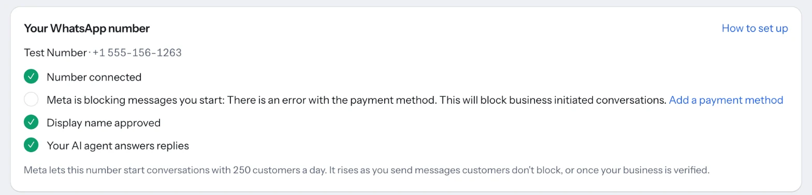
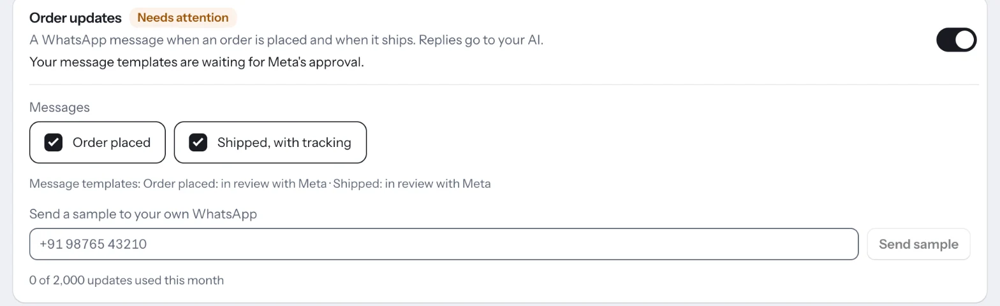
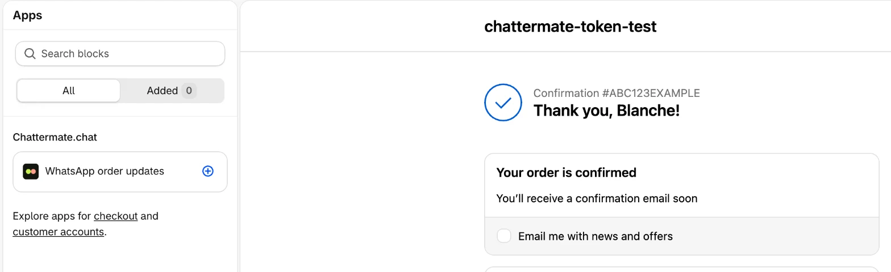
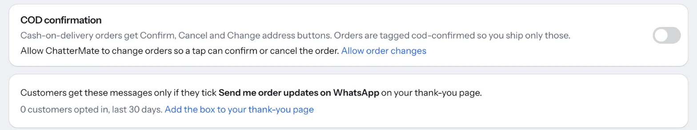

# WhatsApp order updates for Shopify

Send customers a WhatsApp message when their order is placed and when it ships, and ask cash-on-delivery customers to confirm before you ship. Replies go to your AI agent, so "where is my order?" gets answered in the same chat.

Everything is set up from the ChatterMate app inside Shopify admin, under **Apps → ChatterMate → Automations → Order tracking**. Setup takes about 10 minutes, plus Meta's review time.

<Frame>
  <iframe className="w-full aspect-video rounded-xl" src="https://www.youtube-nocookie.com/embed/T8ca7Q2ohm8" title="WhatsApp order updates and COD confirmation for Shopify" allow="accelerometer; autoplay; clipboard-write; encrypted-media; gyroscope; picture-in-picture" allowFullScreen></iframe>
</Frame>

<Info>
WhatsApp comes with the **Growth** plan and up. Messages go out from **your own WhatsApp Business number**, under your store's name. Meta bills your WhatsApp account for each conversation you start.
</Info>

## Before you start

You'll need:

- A **Facebook account**. You'll pick or create your business portfolio while connecting.
- A **phone number** that can get a code by SMS or call, and isn't on the WhatsApp or WhatsApp Business app. Use a new number, or delete that account from the app first.
- A **card** for WhatsApp's conversation charges.

## Step 1 — Connect your WhatsApp number

<Steps>
  <Step title="Open Automations">
    In Shopify admin, open **Apps → ChatterMate → Automations**. Under **On WhatsApp**, click **Connect with Facebook**. If Meta's window doesn't open, allow pop-ups for Shopify admin.
  </Step>
  <Step title="Sign in and choose your business">
    Sign in with Facebook and choose your business portfolio, or create one. ChatterMate fills in your store's name, email, website, address and time zone, so check them and continue.
  </Step>
  <Step title="Create your WhatsApp Business account and profile">
    Choose or create a WhatsApp Business account, then set the **display name** customers will see (usually your store's name) and your business category.
  </Step>
  <Step title="Add and verify your number">
    Enter your phone number and verify it with the code Meta sends by SMS or call. Then confirm the permissions and click **Finish**.
  </Step>
</Steps>

When Meta's window closes, ChatterMate registers the number, routes your store's AI agent to it, and shows a checklist of what Meta still needs:

<Frame>
  
</Frame>

## Step 2 — Add a payment method

Meta won't send messages your business starts until your WhatsApp account has a payment method. If the checklist says **Meta is blocking messages you start**, click **Add a payment method**. Then, in WhatsApp Manager, open **Payment settings** and add a card. The checklist turns green the next time you open the page.

## Step 3 — Wait for the display name review

Meta reviews your display name, usually within a day or two. Messages still go out while it's in review. If Meta declines it, the checklist links to WhatsApp Manager, where you can change it.

<Note>
New numbers can start conversations with 250 customers a day. Meta raises the limit as you send messages customers don't block, or once your business is verified. The checklist shows your current limit.
</Note>

## Step 4 — Turn on order updates

Switch on **Order updates** and choose which messages to send: **Order placed**, **Shipped, with tracking**, or both.

<Frame>
  
</Frame>

Turning it on submits ChatterMate's message templates to Meta for you, as **Utility** templates. You don't need to write or submit anything in WhatsApp Manager. Review usually takes minutes and can take up to 24 hours. The card shows each template's status, and messages start once they're approved.

To see what customers get, type your own WhatsApp number under **Send a sample to your own WhatsApp**.

## Step 5 — Add the opt-in box to your thank-you page

Customers only get WhatsApp order updates if they tick **Send me order updates on WhatsApp** on your thank-you page. Shopify only lets you place blocks on that page yourself, so when you turn on order updates or COD confirmation the card shows **One more step: add the box to your thank-you page**. Click **Add the box** to open the checkout editor. Under **Apps**, add **WhatsApp order updates** to the **Thank you** page, then click **Save**.

<Frame>
  
</Frame>

You can change the checkbox text in the block's settings. Once customers start opting in, the card shows how many did over the last 30 days.

## COD confirmation (optional)

For cash-on-delivery orders, ChatterMate sends a message with **Confirm**, **Cancel** and **Change address** buttons a few minutes after the order. A confirmed order is tagged `cod-confirmed`, so you can ship only those.

<Frame>
  
</Frame>

So a tap can confirm or cancel the order, click **Allow order changes** and approve the permission in Shopify. Then switch on **COD confirmation**, and pick which payment methods count as cash on delivery and how long to wait before sending. You can also choose whether customers may cancel with a button.

## How sending works

- **Only to customers who opted in.** A tick on the thank-you page covers that order's updates.
- **Not at night.** Nothing is sent between 9 pm and 8 am in your store's time zone. Messages wait until morning.
- **Replies go to your AI agent**, and a teammate can take over from the inbox.
- **Customers can reply STOP** to stop all messages from your number, and **START** to get them again.

## Troubleshooting

| What you see | What to do |
|---|---|
| Meta is blocking messages you start | Add a payment method in WhatsApp Manager → **Payment settings**. |
| Message templates: in review with Meta | Wait for Meta's review. Messages start once the templates are approved. |
| A template was rejected | Contact support and we'll look at it with you. |
| Allow order changes | Click it and approve the permission in Shopify so COD buttons can confirm or cancel orders. |
| Nobody has opted in | Check the **WhatsApp order updates** block is on your thank-you page and saved. |

For the WhatsApp channel itself (templates, the 24-hour window, connecting from the ChatterMate dashboard), see [WhatsApp](/features/channels/whatsapp).
