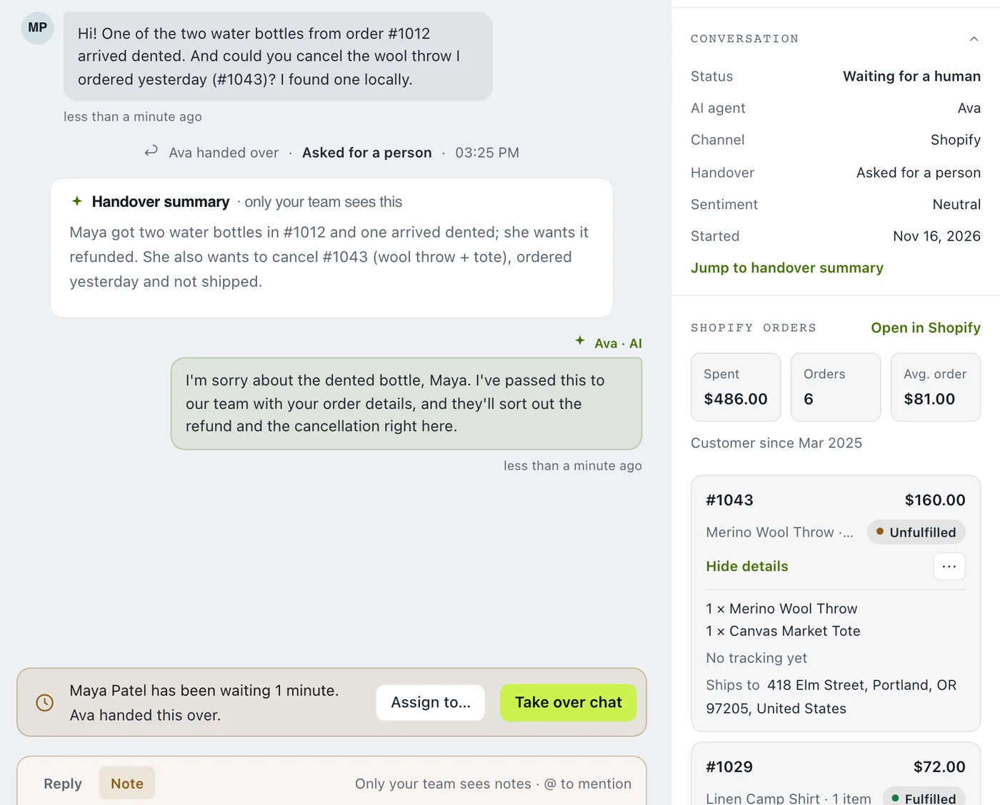
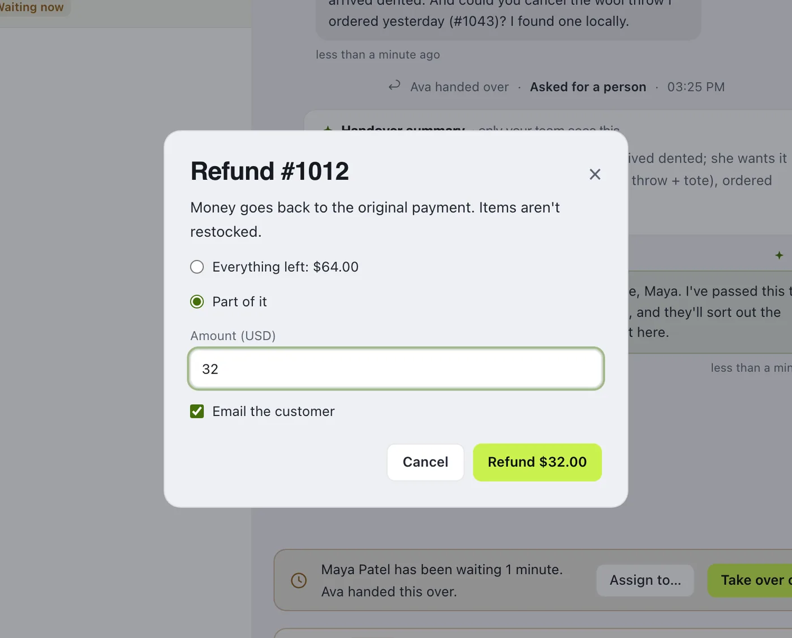
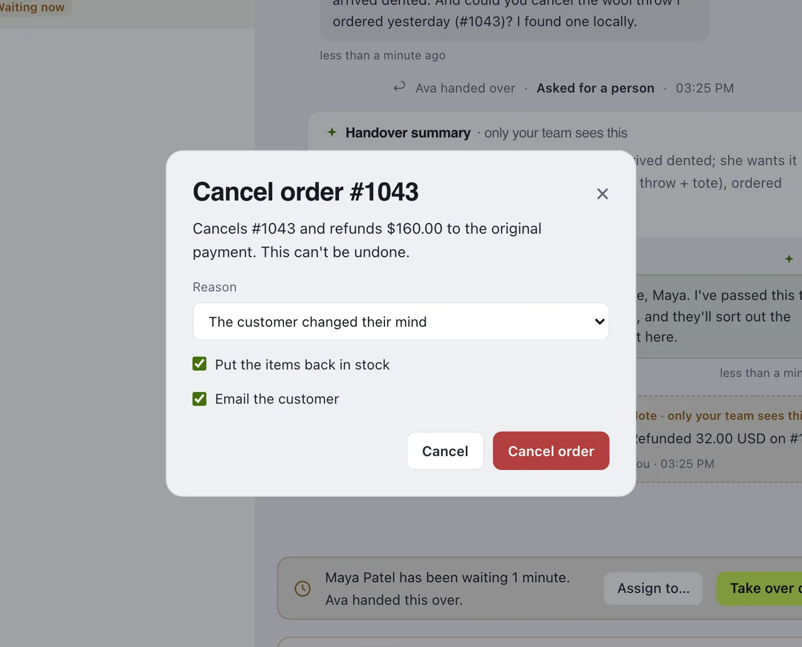
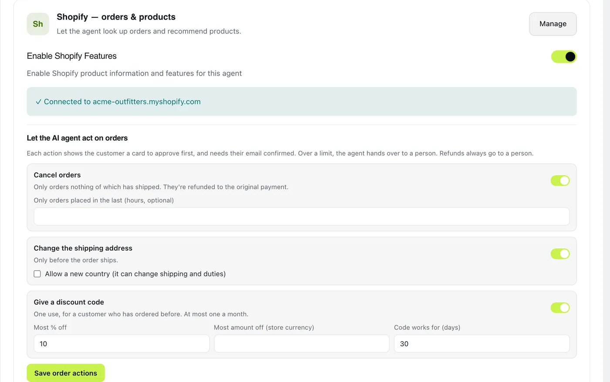
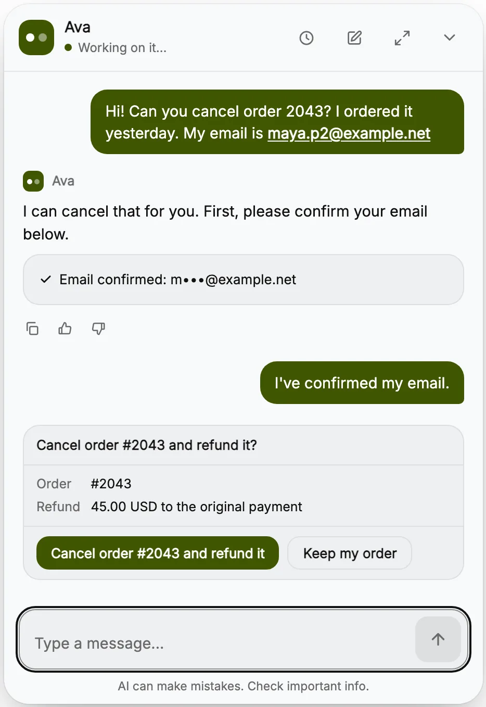
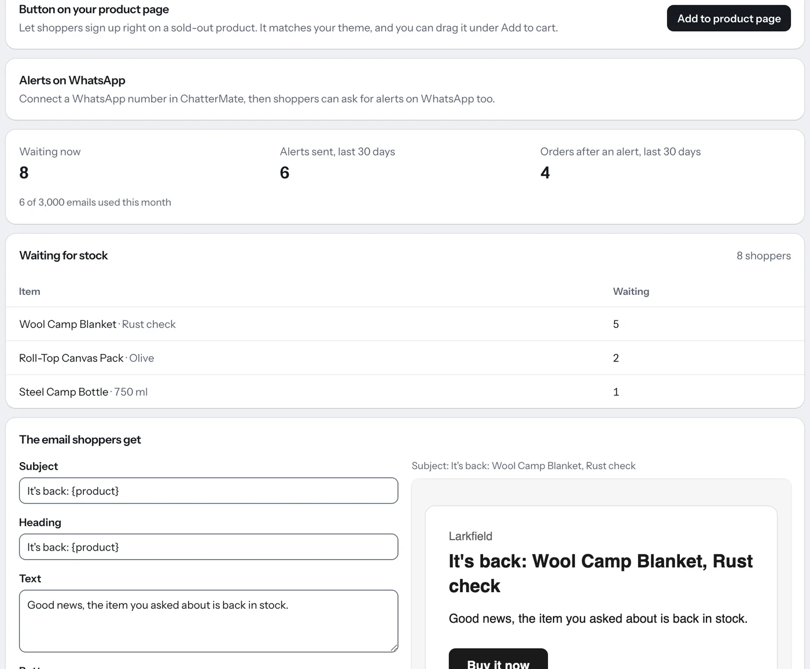

# Shopify

The ChatterMate app for Shopify connects your store to an AI agent and to your team's inbox. Install it from the Shopify App Store, pick the agent that answers your store, and turn on the chat in your theme.

<Frame>
  <iframe className="w-full aspect-video rounded-xl" src="https://www.youtube-nocookie.com/embed/U0MbYO6-EXQ" title="ChatterMate for Shopify: AI chat, order help, stock alerts and WhatsApp order updates" allow="accelerometer; autoplay; clipboard-write; encrypted-media; gyroscope; picture-in-picture" allowFullScreen></iframe>
</Frame>

<Note>
The Shopify app is part of ChatterMate Cloud. Plans bought through the app are billed by Shopify.
</Note>

## What the AI agent does

- **Order tracking.** It shows the order's status and the tracking for every parcel once the customer gives the order number and the email used at checkout. A wrong email gets the same reply as a missing order, so nobody can look up someone else's order.
- **Product answers.** It searches your catalogue from the customer's own words, shows product cards in the website widget and says when an item is sold out. On Growth, customers add to the cart from the card.
- **Orders by email.** On Growth, a customer confirms their email with a code and sees their recent orders without an order number.
- **Handing over.** Refunds, damaged items and anything it can't do go to your team with the whole conversation.

## Orders in the inbox

When a chat's AI agent is connected to Shopify, the customer details beside the thread show:

- what the customer has spent, their number of orders, their average order and how long they've been a customer;
- their latest orders, each with its items, shipping address, tracking and a link that opens it in Shopify.

Orders found by an email the customer only typed, rather than confirmed with a code, say so.

<Frame>
  
</Frame>

## Order actions for your team

On **Growth** and **Pro**, your team acts on an order from the inbox without opening Shopify. Open an order's menu in the customer details:

| Action | When it's offered | What happens |
| --- | --- | --- |
| **Refund** | Something can still be refunded | A full or partial refund to the original payment |
| **Cancel order** | Nothing has shipped | Cancels the order, refunds it to the original payment, and can restock the items and email the customer |
| **Change shipping address** | Nothing has shipped | Saves the new address on the order |
| **Create discount code** | Always | A one-use code for this customer only, as a percent or an amount off, valid for the days you choose |

Each action opens a confirm dialog that says exactly what will happen, checks the order in the store again first, and adds a note to the conversation that only your team sees. Clicking twice never acts twice.

<Frame>
  
</Frame>

<Frame>
  
</Frame>

An order paid outside Shopify's checkout, such as cash or a bank transfer marked as paid, can't be refunded from here: refund it in Shopify.

### Who can do what

Each action has its own role permission (see [Roles & Permissions](/features/roles)):

| Permission | Allows | Default roles |
| --- | --- | --- |
| `refund_orders` | Refunds | Admin |
| `cancel_orders` | Cancelling orders | Admin |
| `edit_orders` | Changing the shipping address | Admin, Agent |
| `create_discounts` | Discount codes | Admin, Agent |

The menu shows only the actions a person's role allows, and the server checks the permission on every action.

## Order actions for the AI agent

On **Pro**, the AI agent can act on orders too. Every action is off until you turn it on, for each agent, under **AI Agents → your agent → Integrations → Let the AI agent act on orders**:

- **Cancel orders** that haven't shipped, optionally only orders placed in the last few hours.
- **Change the shipping address** of an order that hasn't shipped, in the same country unless you allow a new one.
- **Give a discount code**, up to the most percent or amount you set, valid for the days you choose.

<Frame>
  
</Frame>

The AI agent **never refunds**. It can't check a customer's word that something went wrong, so refund requests always go to a person.

Before anything changes:

1. The customer writes the order number and their checkout email in the chat.
2. They confirm the email with a code sent to it. The chat shows the box for it.
3. They approve a card in the chat that says what will happen. If they decline, nothing changes.

<Frame>
  
</Frame>

The server checks everything again after the customer approves, then acts. When a request is outside your limits or something isn't right, the customer isn't shown a card: the agent tells them a teammate will help and hands over, and a note in the conversation tells your team why. A customer gets at most one AI discount code a month, and only if they have ordered from you before.

Turning an action on for the AI needs that action's permission too, so someone who can't cancel orders can't let the AI cancel them. These actions are offered in the website widget only, because it's the one channel that shows the approval card.

## Back-in-stock alerts

On **Starter** and up, shoppers who want a sold-out item get one email when it's back, with a link to buy it.

- **In the chat.** When a shopper asks about a sold-out item, the AI agent offers the alert and signs them up with their email.
- **On the product page.** Add the "Email me when it's back" button to your theme. It matches your theme's buttons, and you can drag it under Add to cart.

To turn alerts on, open the ChatterMate app and click **Set up alerts** on its home. After that the page is under **Automations**. It shows who's waiting for each item, the alerts sent and the orders that followed in the last 30 days. You can change the email's subject, text and button, and send yourself a test. Every email has an unsubscribe link.

Emails come from ChatterMate with your store's name, and replies go to your store's email. On **Growth** and up you can send from your own email, and shoppers can also sign up on WhatsApp once you connect a number. Each plan has a monthly email limit; when it's reached, the rest go out the next month.

<Frame>
  
</Frame>

## WhatsApp order updates

On **Growth** and up, customers who opt in on your thank-you page get a WhatsApp message when their order is placed, ships, goes out for delivery and arrives, and cash-on-delivery orders can be confirmed with a tap. See [WhatsApp order updates for Shopify](/features/shopify-whatsapp-order-updates) for step-by-step setup.

## Allow order actions in Shopify

Order actions need two extra permissions in Shopify: editing orders and discounts. A store owner grants them once:

1. Open the ChatterMate app in your Shopify admin.
2. On the app's home, click **Allow order actions**.
3. Approve Shopify's request.

Until then, the order menu and the AI settings show a link to this page, and the app only reads your store.

<Card title="Chat Management" icon="messages" href="/features/chat-management">
  Next: Learn how your team works in the inbox
</Card>
