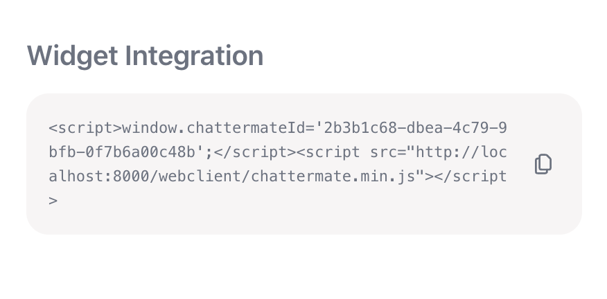
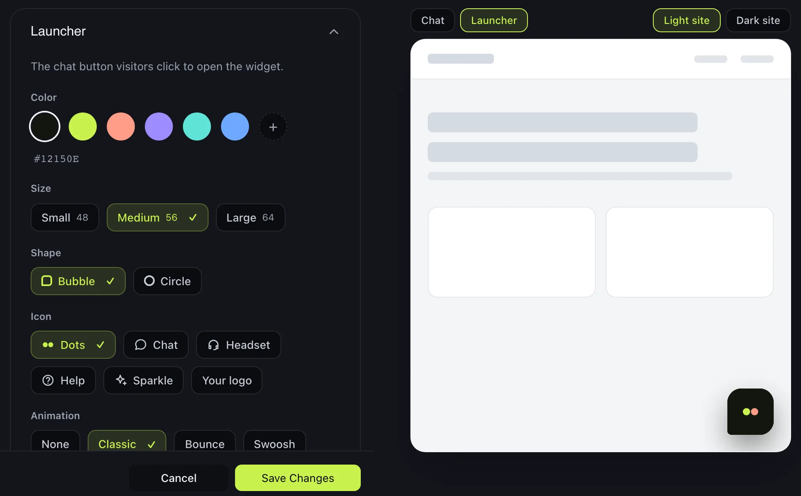

# Widget Integration

Add the ChatterMate chat widget to your website using either direct script integration or iframe embedding, then choose where it sits and how visitors open it.

<Frame>
  
</Frame>

## Integration Methods

### 1. Script Integration (Recommended)

Add the following code snippet to your website's HTML, just before the closing `</body>` tag:

```html
<script>
  window.chattermateId='YOUR_WIDGET_ID';
</script>
<script src="https://app.chattermate.chat/webclient/chattermate.min.js"></script>
```

Replace `YOUR_WIDGET_ID` with your unique widget identifier from the ChatterMate dashboard.

### 2. IFrame Integration

Alternatively, embed the chat widget using an iframe:

```html
<iframe 
  src="https://api.chattermate.chat/api/v1/widgets/YOUR_WIDGET_ID/data"
  frameborder="0"
  width="450" 
  height="600"
  allow="clipboard-write">
</iframe>
```

<Note>
The iframe method is useful for testing or when you need more control over the widget's placement and dimensions.
</Note>

## Placement

By default the launcher is a bubble 20px from the bottom-right corner, and the chat window opens above it. You can change that in two places:

- **In the dashboard** — the **Placement** section of your agent's *Customization* tab. These are the defaults for every site the agent is embedded on.
- **In the embed snippet** — anything you set on the page wins over the dashboard, so one agent can look different on your pricing page than in your docs.

Colours, fonts and the chat design itself are set in the same *Customization* tab; placement is only about where the widget sits and how it opens.

### Ways to present the widget

<CardGroup cols={2}>
  <Card title="Floating bubble" icon="comment">
    `displayMode: 'floating'` — the default, on the left or right, with a chat window above it.
  </Card>
  <Card title="Sidebar drawer" icon="table-columns">
    `displayMode: 'sidebar-left'` or `'sidebar-right'` — a full-height panel sliding in from that edge.
  </Card>
  <Card title="Search bar" icon="magnifying-glass">
    `displayMode: 'search-bar'` — the launcher becomes a search-style bar that opens a centered palette.
  </Card>
  <Card title="No launcher" icon="eye-slash">
    `launcher: false` — nothing is drawn until you open the chat from your own button.
  </Card>
</CardGroup>

<Note>
The **search bar** mode needs the **Ask Anything** or **Aurora** chat design, because those are the two designs that open as a command palette. The dashboard greys the option out for other designs.
</Note>

### Setting placement on the page

Set `window.chattermateConfig` before the loader script. No JavaScript calls needed:

```html
<script>
  window.chattermateId = 'YOUR_WIDGET_ID';
  window.chattermateConfig = {
    displayMode: 'sidebar-right',
    sidebarWidth: 460
  };
</script>
<script src="https://app.chattermate.chat/webclient/chattermate.min.js"></script>
```

`ChatterMate.init()` takes exactly the same options if you prefer to configure the widget after the script has loaded:

```javascript
ChatterMate.init({
  id: 'YOUR_WIDGET_ID',
  displayMode: 'floating',
  position: { side: 'left', bottom: 90, offset: 24 },
  width: 520,
  height: 700
});
```

### Options

| Option | Type | Default | Description |
| --- | --- | --- | --- |
| `id` | string | — | Your widget ID. Same value as `window.chattermateId`. |
| `displayMode` | `'floating'` · `'sidebar-left'` · `'sidebar-right'` · `'search-bar'` | `'floating'` | How the widget is presented. |
| `position.side` | `'left'` · `'right'` | `'right'` | Which edge the launcher and window hug. |
| `position.bottom` | number (px) | `20` | Distance from the bottom edge. Raise it to clear a fixed bottom bar. |
| `position.offset` | number (px) | `20` | Distance from the chosen side edge. |
| `width` | number (px) | `400` | Chat window width in floating mode (280–800). |
| `height` | number (px) | `560` | Chat window height in floating mode (400–900). |
| `launcherStyle` | object | dashboard | The launcher's `size`, `shape`, `icon` and `animation` — see [Launcher](#launcher). |
| `sidebarWidth` | number (px) | `420` | Drawer width in the sidebar modes (320–640). |
| `searchBar.placeholder` | string | `'Ask anything...'` | Text shown in the search bar, up to 80 characters. |
| `searchBar.width` | number (px) | `320` | Width of the search bar trigger. |
| `launcher` | boolean | `true` | `false` hides the built-in launcher — see [Using your own button](#using-your-own-button). |
| `trigger` | CSS selector | — | Elements that toggle the chat when clicked. |
| `zIndex` | number | `999999` | Stacking base, if the widget collides with your own overlays. |
| `hotkey` | boolean | `true` | `false` releases ⌘K / Ctrl+K, if your site already uses it. |
| `baseUrl` | string | cloud API | Self-hosted only — your API URL. Usually set via `window.chattermateBaseUrl`. |
| `tokenProvider` | async function | — | Returns a fresh `/generate-token` token when the widget can no longer renew the visitor's identity — see [Staying signed in](#staying-signed-in-on-a-long-lived-page). |

<Note>
The legacy form `position: { bottom, right }` still works — `right` is treated as `offset` — so existing installations need no changes.
</Note>

You can also reposition the widget after it has loaded, which is useful when your layout changes:

```javascript
ChatterMate.setPosition({ side: 'left', bottom: 100, offset: 24 });
```

### Mobile

On small screens the chat always opens full-screen, whichever display mode you choose. Your offsets still control where the closed launcher sits, so it can be kept clear of a bottom navigation bar.

<CodeGroup>
```css Desktop
width: 400px;
height: 560px;
border-radius: 24px;
```

```css Mobile
width: 100%;
height: 100vh;
border-radius: 0;
```
</CodeGroup>

## Launcher

The launcher is the button visitors click to open the chat. Change how it looks in the **Launcher** section of your agent's *Customization* tab; the preview next to the form shows it at its real size on a light or dark page.

<Frame>
  
</Frame>

| Setting | Choices |
| --- | --- |
| Colour | Any colour. The default is the ChatterMate mark: a dark tile with a lime and a coral dot. |
| Size | Small (48px), Medium (56px) or Large (64px). New agents start at Medium. |
| Shape | Bubble or Circle. |
| Icon | Dots, Chat, Headset, Help or Sparkle — or your own logo on paid plans. |
| Animation | None, Classic, Bounce — or Swoosh and Glow on paid plans. |

Bounce, Swoosh and Glow play when the page loads and then every 12 seconds, and stop for good once the visitor has opened the chat. Classic is the gentle float the launcher has always had. Visitors who have asked their device for less motion see no animation at all.

On phones the launcher is never larger than 56px.

### Your own logo

On paid plans you can upload a PNG, WebP or JPEG of up to 1 MB, at least 96px wide and tall. ChatterMate re-saves it as a small square image, so a wide logo is fitted inside the square rather than cropped. Choose what sits behind it:

- **White** or **Brand color** — the logo sits on a button of that colour.
- **None** — the logo floats on the page by itself. Only offered for files with a transparent background. While the chat is open, a button appears behind the close arrow so visitors can still find it.

The logo is uploaded when you press **Save**, so **Cancel** leaves the live launcher as it was. If your plan changes, visitors see the dots and the Classic animation instead; your logo and animation choice are kept, and come back when you upgrade.

<Note>
If your site's Content Security Policy blocks images from ChatterMate, the launcher shows the dots instead of your logo.
</Note>

### Setting the launcher on the page

Like placement, anything set in the embed snippet wins over the dashboard, one setting at a time:

```html
<script>
  window.chattermateId = 'YOUR_WIDGET_ID';
  window.chattermateConfig = {
    launcherStyle: { size: 'sm', shape: 'circle', icon: 'help', animation: 'none' }
  };
</script>
```

| Key | Values |
| --- | --- |
| `size` | `'sm'` · `'md'` · `'lg'` |
| `shape` | `'bubble'` · `'circle'` |
| `icon` | `'dots'` · `'chat'` · `'headset'` · `'help'` · `'sparkle'` |
| `animation` | `'none'` · `'classic'` · `'bounce'` |

The logo and the paid animations can only be chosen in the dashboard. Unknown values are ignored.

The launcher works from the keyboard: it can be focused with Tab and opened with Enter or Space, and it tells screen readers whether the chat is open.

### Chat window size

The **Placement** section also sets the size of the chat window: **Compact** (360 × 520), **Standard** (400 × 560), **Large** (440 × 680) or **Custom**. The `width` and `height` options in the snippet win over it. The presets are hidden for the Ask Anything and Aurora designs, which open as a palette; their width and height can still be typed in.

## Using your own button

Hide the built-in launcher and open the chat from an element of your own. There are three ways, and none of them requires you to write an event handler.

<Tabs>
  <Tab title="data-chattermate-open">
    Add the attribute to any element. It works for elements added to the page later, too.

    ```html
    <button data-chattermate-open>Chat with us</button>
    ```
  </Tab>

  <Tab title="A CSS selector">
    Point `trigger` at your own selector — handy when you cannot change the markup.

    ```html
    <script>
      window.chattermateId = 'YOUR_WIDGET_ID';
      window.chattermateConfig = {
        launcher: false,
        trigger: '.js-support-link'
      };
    </script>
    <script src="https://app.chattermate.chat/webclient/chattermate.min.js"></script>
    ```
  </Tab>

  <Tab title="The JS API">
    Call the API from your own code.

    ```javascript
    document.querySelector('#help').addEventListener('click', () => {
      ChatterMate.open();
    });
    ```
  </Tab>
</Tabs>

<Warning>
With the launcher hidden there is nowhere to show the unread badge or the greeting nudge. Listen for the [`unread` event](#events) if you want to show a count on your own button.
</Warning>

## JavaScript API

`window.ChatterMate` is available as soon as the loader script runs. Calls that arrive before the widget has finished loading are queued and applied once it is ready, so you do not have to wait.

| Method | Description |
| --- | --- |
| `ChatterMate.init(options)` | Configure the widget. Same options as `window.chattermateConfig`. |
| `ChatterMate.open(options?)` | Open the chat. Pass `{ message }` to prefill the input. |
| `ChatterMate.close()` | Close the chat. |
| `ChatterMate.toggle()` | Open if closed, close if open. |
| `ChatterMate.isOpen()` | `true` while the chat is open. |
| `ChatterMate.showLauncher()` | Show the built-in launcher. |
| `ChatterMate.hideLauncher()` | Hide the built-in launcher. |
| `ChatterMate.setPosition(position)` | Move the widget: `{ side, bottom, offset }`. |
| `ChatterMate.identify(token)` | Switch to the visitor the token identifies (SPA login). |
| `ChatterMate.logout()` | Drop the current identity and conversation, back to anonymous. |
| `ChatterMate.destroy()` | Remove the widget from the page entirely. |
| `ChatterMate.reload()` | Rebuild the widget, and bring back a destroyed one. |
| `ChatterMate.on(event, handler)` | Subscribe to an event. |
| `ChatterMate.off(event, handler)` | Unsubscribe. |

### Prefilling a message

`open({ message })` puts text in the input without sending it, so the visitor can edit it or just press enter. Good for "Ask about pricing" links next to a plan:

```javascript
ChatterMate.open({ message: 'Tell me about the Pro plan' });
```

### Login and logout in a single-page app

The widget's identity is fixed when it loads — the token it starts with decides whose
conversation it shows. An app that signs a visitor in or out without reloading the page
has to say so, or the widget keeps the identity it had when the script first ran:
anonymous after a login, the previous user after a logout.

```javascript
// After login — token from your backend's /generate-token call
ChatterMate.identify(token);

// After logout — back to a fresh anonymous visitor
ChatterMate.logout();
```

A change of visitor rebuilds the widget in place: the chat closes, the previous
conversation is closed on the server too, and the widget reloads as the new person.
`identify()` with the token the widget is already running on does nothing, so it is safe
to call on every route change.

Handing `identify()` a **fresher token for the same visitor** is not a change of
identity: the widget takes the new token and keeps the conversation open, so
re-authenticating never costs someone the chat they are in the middle of.

Two more lifecycle methods:

```javascript
ChatterMate.destroy();   // take the widget off the page completely
ChatterMate.reload();    // rebuild it — also brings back a destroyed widget
```

`destroy()` removes the launcher, the chat frame, the injected styles, and every listener
and timer the loader added, so nothing of ours is left on the page. It does not clear the
stored identity — a later `reload()` comes back as the same visitor, so use `logout()` if
that is what you want.

<Note>
With [token authentication](/features/authentication) required, `logout()` leaves the
widget without a token and it cannot load. Pair it with `hideLauncher()`, or call
`destroy()` instead.
</Note>

### Staying signed in on a long-lived page

A token from `/generate-token` lasts as long as you asked for — an hour by default. The
widget renews it on its own well before it lapses, so a tab left open all day keeps the
visitor signed in, and a new chat they start hours later still arrives in your inbox as
that person, with their `custom_data`.

Renewal keeps the same customer and the same lifetime, and stops if you revoke the
token. It cannot run forever: after 30 days your app has to identify the visitor again.

That only leaves the case where the widget has no live token to renew — the tab was
asleep past the expiry, or the token was revoked. The widget cannot mint one itself
(that needs your API key), so give it a way to ask:

```javascript
window.chattermateConfig = {
  tokenProvider: async () => {
    const res = await fetch('/api/chattermate-token');   // your endpoint
    return (await res.json()).token;                     // from /generate-token
  }
};
```

`tokenProvider` is called only when the widget needs a token you alone can issue. The
replacement is handed to the running widget, so the visitor keeps the conversation they
were in. Without one, the widget falls back to an anonymous visitor and fires
[`identityExpired`](#events) so you can react yourself.

<Note>
Return a token for the **same** person. `tokenProvider` replaces an identity that ran
out; it is not a way to switch visitors — use `identify()` for that.
</Note>

### Events

| Event | Fires when | Payload |
| --- | --- | --- |
| `ready` | The widget has loaded and the API is live | — |
| `open` | The chat opens | — |
| `close` | The chat closes | — |
| `unread` | The unread agent-message count changes | `count` (number) |
| `chatCreated` | A new conversation starts — the visitor used **New chat**, or this is their first of the visit | `{ sessionId, authenticated }` |
| `identityExpired` | The token the widget was identified with has run out and cannot be renewed | — |

```javascript
ChatterMate.on('ready', () => console.log('widget ready'));
ChatterMate.on('open', () => analytics.track('chat_opened'));
ChatterMate.on('unread', (count) => {
  document.querySelector('#chat-badge').textContent = count || '';
});

ChatterMate.on('chatCreated', ({ sessionId, authenticated }) => {
  if (!authenticated) console.warn('new chat started as an anonymous visitor');
});
```

`authenticated` is `false` when the conversation belongs to an anonymous visitor rather
than the person you identified — a signal that the widget is running without a live
token from `/generate-token`.

<Note>
`ready` fires only once. If you subscribe after it has already happened — for example from consent-gated or lazily loaded code — your handler is called immediately rather than never.
</Note>

## Event Handling

The widget supports the following events:

### Token Management
```javascript
// Listen for token updates from the widget
window.addEventListener('message', (event) => {
  if (event.data.type === 'TOKEN_UPDATE') {
    // Store the token securely
    const token = event.data.token;
    localStorage.setItem('ctid', token);
  }
});
```

### Scroll Control
```javascript
// Scroll chat to bottom
window.postMessage({
  type: 'SCROLL_TO_BOTTOM'
}, '*');
```

## Security Features

<Warning>
- Tokens are encrypted and stored securely
- Communication uses postMessage for security
- Automatic token management
- Domain validation for widget loading
</Warning>

## Widget Features

What visitors get in the chat:

- **Start screen** — your welcome message and quick actions to tap. With **Collect email before chat** on, an email card holds the visitor's first message until they give their email.
- **Answers** — written out as they arrive, with numbered sources and links. While the agent works, the steps it takes (such as *Searching the help center*) show and then fold into a short note on the reply.
- **Follow-up questions** — up to three questions to ask next, under the latest answer.
- **Handover** — a card when the chat goes to your team, or when nobody is online.
- **Your conversations** — the visitor's past chats, under the clock button or the *Recent* row. They can search them and continue one.
- **Suggested for this page** — up to three rows for the page the visitor is on.
- **Shopping** — on a Shopify store, product cards, a sheet for sizes and colours, **Add to cart** and a cart bar with *View cart* and *Checkout*.
- **Orders** — order and ticket cards with status and delivery. The agent can look up an order by its number, or check the visitor's email with a 6-digit code and list their orders.
- **Signed-in Shopify customers** — a customer signed in to your store chats as themselves.
- **New chat** — ends the current chat and starts a fresh one. Hidden while a teammate is handling the chat.
- **Files** — visitors can attach images and documents. See [File Attachments](/features/file-attachments).

### Features by plan

On ChatterMate Cloud, each widget feature comes with a plan. Each plan includes everything in the plans above it.

| Plan | Widget features |
| --- | --- |
| **Free** | Answers, handover to your team, product cards with *View product*, order lookup by order number |
| **Starter** | Quick actions, your conversations, follow-up questions, greeting messages |
| **Growth** | Suggested for this page, **Add to cart** and the cart bar, *My orders* after an email check, AI titles for past chats |
| **Pro** | Signed-in Shopify customers, past chats from the visitor's other browsers after an email check |

On a lower plan the dashboard locks those settings with an upgrade prompt and the widget stops showing them. Anything you saved stays saved and comes back when you upgrade.

Self-hosted installs have every widget feature.

### Availability
The line under the agent's name reflects who is answering.

- While the AI is answering it reads **Replies instantly**, which holds at any hour, and *Working on it…* while a reply is on its way
- When a person has to answer — an agent in [human mode](/features/ai-customization#let-ai-answer),
  or a chat a teammate has taken over — it follows your organization's
  [business hours](/features/organization): *Online · usually replies in a few minutes* while you are
  open, *Away · we'll reply when we're back* outside them

### Styling
The widget uses CSS variables for consistent theming:
```css
:root {
  --primary-color: #f34611;
  --background-base: #ffffff;
  --text-color: #1F2937;
  --border-color: #E5E7EB;
  --radius-lg: 24px;
  --space-md: 16px;
  --space-sm: 8px;
}
```

## Testing Your Integration

### Test Project
We provide a sample test project at `github.com/chattermate/chattermate.chat/tree/main/chattermate-test`:

1. Clone and setup:
```bash
git clone https://github.com/chattermate/chattermate.chat
cd chattermate.chat/chattermate-test
npm install
```

2. Start test server:
```bash
npm start
```

3. Open `http://localhost:3000` and enter your widget ID

The test project demonstrates:
- Basic widget initialization
- Token management
- Style customization
- Mobile responsiveness

### Placement gallery

`http://localhost:3000/ui-options.html` is a gallery of every placement option — one card per scenario, each opening a page with the widget configured that way and buttons wired to the JS API.

Each card runs in one of two modes, chosen at the top of the gallery:

- **Stub** fakes the widget entirely, so you can check placement, the JS API and the events with no backend running.
- **Real** loads your actual widget — fill in your widget ID and API URL first.

## Best Practices

1. **Implementation**
   - Add script just before closing body tag
   - Enable secure token storage
   - Test on multiple browsers
   - Verify mobile responsiveness

2. **Security**
   - Store tokens securely
   - Use HTTPS only
   - Implement proper CSP headers
   - Enable domain restrictions

3. **User Experience**
   - Test email collection flow
   - Verify history loading
   - Check offline behavior
   - Test connection handling

## Troubleshooting

<AccordionGroup>
  <Accordion title="Token Issues">
    - Verify localStorage access
    - Check token storage events
    - Clear stored tokens and retry
    - Verify domain permissions
  </Accordion>
  
  <Accordion title="Display Problems">
    - Check CSS variables
    - Verify mobile breakpoints
    - Test iframe dimensions
    - Validate color codes
  </Accordion>

  <Accordion title="Nothing appears on the page">
    - Check whether **Hide launcher** is on in the *Widget placement* section — with no launcher, the chat only opens from your own button or `ChatterMate.open()`
    - If your site has a high-stacking header or modal, raise `zIndex`
    - Confirm the loader script actually loaded and `window.ChatterMate` is defined
  </Accordion>

  <Accordion title="The widget still shows the previous user after login or logout">
    - In a single-page app the widget keeps the identity it loaded with — call `ChatterMate.identify(token)` after login and `ChatterMate.logout()` after logout (see [login and logout in a single-page app](#login-and-logout-in-a-single-page-app))
    - `identify()` ignores an empty token, so check yours is a real string and not `undefined` stringified by your auth store
    - Handing `identify()` a fresher token for the same person keeps their conversation rather than rebuilding — use `reload()` if you actually want a rebuild
  </Accordion>

  <Accordion title="The search bar mode is greyed out">
    - It needs the **Ask Anything** or **Aurora** chat design, set under *Customization → Chat design*
  </Accordion>
  
  <Accordion title="Connection Issues">
    - Verify widget ID
    - Check network connectivity
    - Test WebSocket connection
    - Validate API endpoints
  </Accordion>
</AccordionGroup>

## What's Next?

After integrating the widget:

1. Test customer identification flow
2. Verify conversation persistence
3. Monitor connection stability
4. Test mobile responsiveness

<Card title="Human Agents" icon="user-headset" href="/features/human-agents">
  Next: Learn how to manage human agents
</Card> 