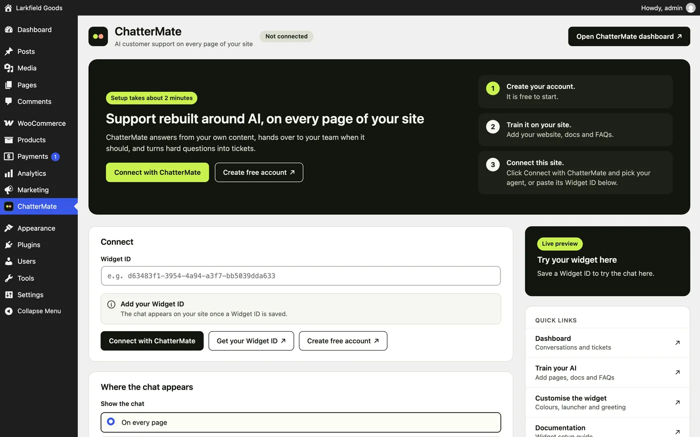
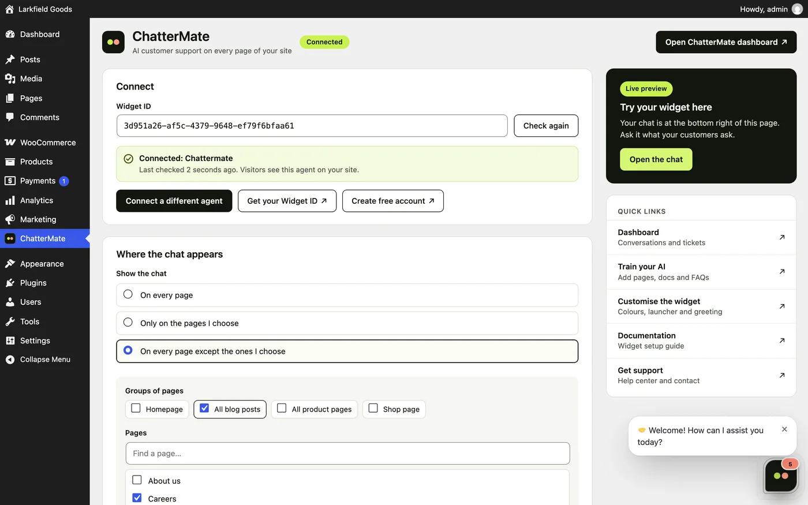
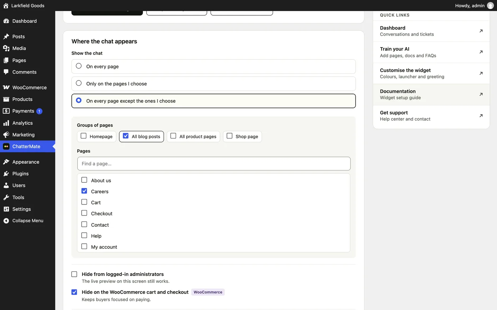

# WordPress & WooCommerce

The **ChatterMate Chat** plugin puts the ChatterMate chat on your WordPress site without touching your theme. Connect it in one click, let the AI agent learn your pages, posts and WooCommerce products, and choose where the chat appears.

<Frame>
  <iframe className="w-full aspect-video rounded-xl" src="https://www.youtube-nocookie.com/embed/h_E38Hp5688" title="ChatterMate on WordPress and WooCommerce: connect, learn the store and answer customers in the chat" allow="accelerometer; autoplay; clipboard-write; encrypted-media; gyroscope; picture-in-picture" allowFullScreen></iframe>
</Frame>

<Note>
You need a ChatterMate account. The Free plan is enough to start. The plugin needs WordPress 6.3 or later and PHP 7.4 or later.
</Note>

## Install the plugin

1. In your WordPress admin, go to **Plugins → Add New**.
2. Search for **ChatterMate Chat** and click **Install Now**, then **Activate**.
3. Open **ChatterMate** in the admin menu.

The plugin is also on [WordPress.org](https://wordpress.org/plugins/chattermate-chat/), where you can download the zip and upload it under **Plugins → Add New → Upload Plugin**.

## Connect your AI agent

On the ChatterMate screen, click **Connect with ChatterMate**:

1. ChatterMate opens in a new page. Sign in if asked, or create a free account.
2. Pick the AI agent that should answer your site.
3. Leave **Teach the AI my pages and products** ticked (see [below](#teach-the-ai-your-site)) and click **Connect**.

You're sent back to WordPress with the chat live on your site.

<Frame>
  
</Frame>

**Or paste a Widget ID.** In ChatterMate, open **AI Agents → your agent → Widget** and copy the Widget ID (the [widget guide](/features/widget) shows where). Paste it into **Widget ID** in WordPress and click **Save changes**. Pasting an ID doesn't teach the AI your site.

The screen then checks the widget with ChatterMate and shows the AI agent that answers. If something is wrong, such as a widget with no agent, it says what to fix. Click **Check again** after fixing it, and **Show live preview** to try the real chat on that screen.

<Frame>
  
</Frame>

## Teach the AI your site

With **Teach the AI my pages and products** ticked, ChatterMate reads your site through the WordPress REST API instead of crawling it:

- **What it reads:** your published pages first, then your WooCommerce products, then your posts, up to your plan's page limit. Only content any visitor can see.
- **What it skips:** the WooCommerce cart, checkout and account pages, and pages with almost no text.
- **Keeping up:** when you publish, update or unpublish a page, post or product, or a product's stock changes, your site tells ChatterMate, and it reads the site again soon after. Pages you removed drop out of what the AI knows.

The site counts as one knowledge source on your plan, and it shows up with your agent's other [knowledge](/features/knowledge-base).

Things that stop the learning, and what WordPress tells you:

| Message | What to do |
| --- | --- |
| Your plan has no room for another knowledge source | Remove a source in ChatterMate, then connect again |
| This agent already learns another site | Disconnect the other site (see [Disconnect](#disconnect)), then connect again |
| The site answered 401, 403 or 404 | A security plugin may be closing the REST API to visitors. Allow it for pages and posts, or add the site as a website in ChatterMate instead |

<Note>
One-click connect and site learning are on ChatterMate Cloud. Self-hosted installs paste the Widget ID and set their own script and API URLs under **Advanced**.
</Note>

## WooCommerce in the chat

When WooCommerce is active and the AI has learned the store, the agent can show products and check orders.

### Product cards

The AI searches your store's products from the customer's own words, including a price ("mugs under 30"), and shows them as cards in the chat with the price and a **View product** link. Sold-out products say so.

On **Growth** and above, customers add to the cart from the card. The product goes into their cart through your store's own Store API, in their browser, and your theme's cart updates. Products with choices, such as sizes or colours, show **View product** so the customer picks them on the product page.

The AI never adds anything to the cart itself: the customer clicks.

### Order status

On every plan, a customer can ask about an order in the chat. The AI asks for the **order number** and the **billing email** used at checkout, and your site answers only when both match. If either is wrong, the customer is told no order matched, so nobody can look up someone else's order.

The chat shows the order's status, date, items, totals, city, postcode and country, and any tracking numbers from WooCommerce Shipment Tracking. It **never shows the street address or phone number**.

Lookups that match nothing are limited, for each conversation and for your store, so order numbers can't be guessed.

## Where the chat appears

Under **Where the chat appears**:

- **Show the chat:** on every page, only on the pages you choose, or on every page except the ones you choose. Besides single pages, rules can cover the homepage and all blog posts, and with WooCommerce all product pages and the shop page.
- **Hide from logged-in administrators** while you work on the site. The live preview still works.
- **Hide on the WooCommerce cart and checkout** so buyers stay focused on paying.
- **Load the chat** as soon as the page loads, or when the visitor first scrolls, taps, moves the mouse or types. The second keeps the chat out of PageSpeed tests.

<Frame>
  
</Frame>

Changes go live as soon as you click **Save changes**.

### Personal answers

- **Tell the AI what the visitor is looking at** (on by default): the page they're on and, in a WooCommerce store, the product on a product page and what's in their cart when they open the chat.
- **Recognise signed-in customers**: visitors logged in to your site chat under their WordPress name and email. Create an API key in ChatterMate under **Settings → Widget Apps** and paste it here. ChatterMate trusts the email your site sends, so turn this on only if your site confirms email addresses.

### Chat buttons

Add the **Chat button** block anywhere, or the `[chattermate_button label="Chat with us" message="Where is my order?"]` shortcode. The message is typed into the chat for the visitor, who decides whether to send it. A menu link to `#chattermate` opens the chat too. Buttons only show on pages where the chat is allowed.

## Disconnect

- **Stop the AI learning the site, keep the chat:** click **Connect a different agent**, untick **Teach the AI my pages and products** and connect again. ChatterMate stops reading the site and looking up orders.
- **Remove the chat for now:** deactivate the plugin under **Plugins**. The chat disappears from your site.
- **Remove everything:** deactivate and delete the plugin. ChatterMate stops reading the site and looking up orders, and the plugin's settings, saved API key and tokens are removed from WordPress.

What the AI already learned stays as a knowledge source in ChatterMate until you remove it there. Your ChatterMate account and conversations are never touched.

<Card title="Knowledge Base" icon="book" href="/features/knowledge-base">
  Next: Add docs, FAQs and other websites to what your AI agent knows
</Card>
